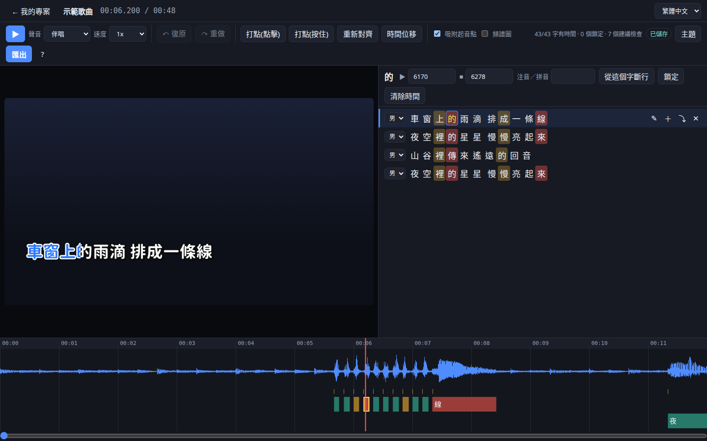
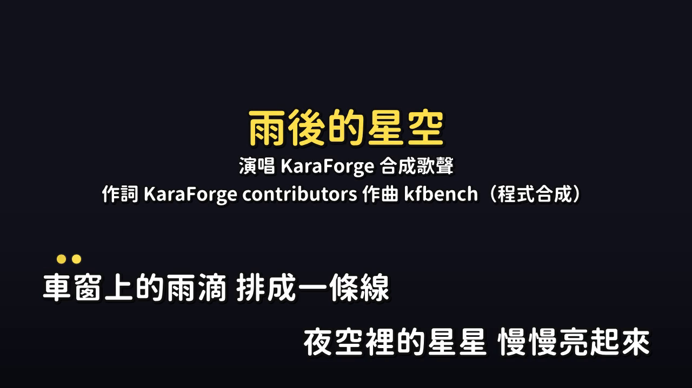
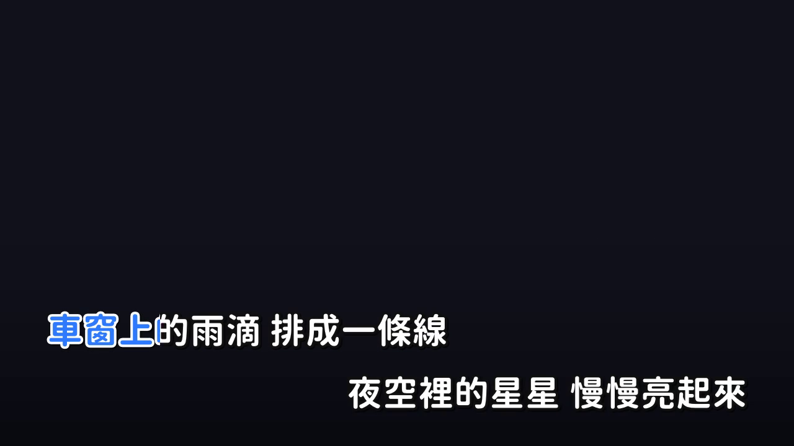
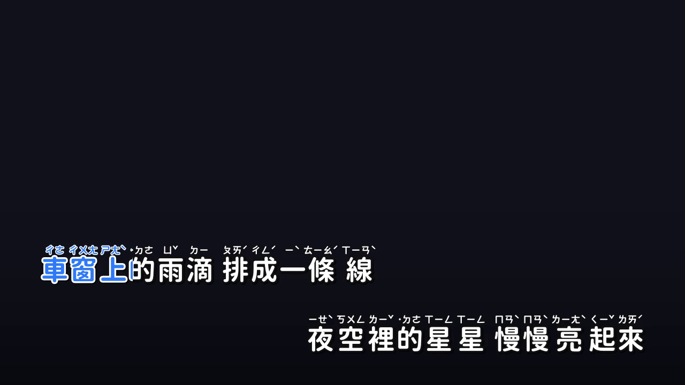

# KaraForge

**An open-source karaoke (KTV) video generator.** Give it a song (video or audio) and its lyrics;
it aligns the lyrics automatically down to **every single character**, lets you fine-tune the
result in a web editor, and exports a Taiwanese-KTV-style karaoke video — each character changes
colour, outline included, the moment it is sung.

繁體中文：[README.md](README.md) (the primary document; this file is its translation)



| Exported video: title card and countdown | Sung characters change colour, outline included | The zhuyin-learner theme |
|---|---|---|
|  |  |  |

These are frames of the video in [`examples/demo/`](examples/): a synthesised song, processed fully
automatically, nothing corrected by hand.

## What it does

- **Automatic per-character alignment.** Vocal separation → speech recognition → three-pass
  alignment (locate each line, align the characters inside it, snap to note onsets), with a
  confidence score per character.
- **Semi-automatic correction.** The editor highlights the characters it is unsure about; fix
  them by dragging, by tapping along with the music, or by typing a time. Corrected characters
  are locked, and the next "Re-align" uses them as anchors.
- **What you see is what you export.** The browser preview and the final video use the same
  subtitle script, the same renderer (libass) and the same font files.
- **KTV layout.** Two alternating rows, left-to-right fill including the outline, a countdown
  after long pauses, male / female / duet colours, a title card, Zhuyin or Pinyin readings. Four
  built-in themes, adjustable in the editor.
- **Many inputs and outputs.** Media: a video or audio file, or the link of a video on YouTube
  or another site (optional, needs [yt-dlp](#optional-projects-from-a-video-link-yt-dlp)).
  Lyrics: plain text, LRC (line- or word-timed), SRT, ASS — or no lyrics at all (speech
  recognition drafts them). Output: MP4, MKV (soft subtitles plus karaoke
  and original audio tracks), ASS, LRC, enhanced LRC, SRT, UltraStar.
- **Runs on your own machine.** Once the models are downloaded no network is needed (unless you
  choose to download a video from a link); no account, no telemetry. A CPU is enough, and every default model has a permissive licence.
- **CLI and web UI share one project format** (a folder with a readable `project.json`); whole
  folders can be processed in a batch.

## How accurate is it — and what we do not know

We measure on songs we synthesise ourselves (text-to-speech singing plus a synthetic backing
track, so the true time of every character is known). The **default `balanced` profile** on the
test split (30 songs × 4 signal-to-noise ratios = 120 audio files, 7480 tokens):

| Lyrics | Median start error | P95 | Tokens needing a manual fix (error > 0.15 s) |
|---|---:|---:|---:|
| Chinese | 12 ms | 124 ms | 4.3% |
| English | 17 ms | 147 ms | 4.8% |
| Mixed Chinese / English | 16 ms | 402 ms | 10.5% |

The specification's targets (Chinese at 10 dB: median ≤ 60 ms, P95 ≤ 250 ms, ≤ 10 % needing a
fix, ≤ 5 % after locking 5 % of the tokens as anchors) are all met: 11 ms, 86 ms, 2.8 % and
3.0 %. Full tables, including the ablation study and the comparison of aligners:
[docs/benchmark-report.md](docs/benchmark-report.md); method: [docs/benchmark.md](docs/benchmark.md)
(both in Chinese).

Read these numbers as an **upper bound**. Plainly:

- **All of it is synthetic singing** — clear diction, no melisma, no backing vocals, a simple
  accompaniment. Real songs will be worse, and by how much **has not been measured** (the
  project cannot ship copyrighted songs). You can measure on your own songs: see
  [bench/real/README.md](bench/real/README.md).
- **Mixed-language lyrics are clearly weaker**: about one token in ten needs fixing.
- **`cpu-lite` (the smallest model set) is much worse**: its aligner leaves about a fifth of
  the tokens needing a fix on the same data.
- **Lyric drafts from speech recognition are mostly wrong**: on the one example we measured, the
  best profile got half of the characters right. If you have the lyrics, use them.
- Developed on a machine without a GPU: **CUDA, Apple MPS, macOS and Windows are untested.**

## Installation

You need Python 3.11+, [uv](https://docs.astral.sh/uv/), an ffmpeg build with libass, and
Node.js 22.12+ (only to build the web UI; development used 26). Allow about 3 GB for models.
There is no PyPI release yet: install from source or use Docker.

### Native

```bash
git clone <repository-url> karaforge
cd karaforge

uv sync --extra cpu                 # with an NVIDIA card: --extra cuda
source .venv/bin/activate           # Windows: .venv\Scripts\activate
(cd web && npm ci && npm run build) # build the web UI (skip it for CLI-only use)

kf doctor                           # checks ffmpeg, fonts, the compute device, missing models
kf models download                  # models of the default profile (balanced), about 2.2 GB
```

Every command below assumes the virtual environment is active. **Do not use `uv run kf …`**:
`uv run` first syncs the environment back to the set *without* `--extra`, which swaps the CPU
build of PyTorch for the multi-gigabyte CUDA build. If you must, add `--no-sync`.

Messages are in Traditional Chinese by default; set `KARAFORGE_LANG=en` for English. The web UI
has a language switch.

ffmpeg: `sudo apt install ffmpeg` (Ubuntu / Debian), `brew install ffmpeg` (macOS),
`winget install Gyan.FFmpeg` (Windows, the full build). `kf doctor` tells you whether the ffmpeg
it found has libass; without it you can still export MKV and subtitle files, but not burn
lyrics into an MP4. Where system packages cannot be installed, ffmpeg can be wrapped in Docker:
[docker/ffmpeg-wrapper/README.md](docker/ffmpeg-wrapper/README.md).

### Optional: projects from a video link (yt-dlp)

With [yt-dlp](https://github.com/yt-dlp/yt-dlp) installed, "New project" also takes the link of a
video on YouTube or another site: it shows the thumbnail, title and length first, downloads in
the background once you start (at most 1080p, preferring H.264 with stereo AAC in an MP4) and
then processes the song as usual. Install it with `brew install yt-dlp` (macOS) or
`pipx install yt-dlp`. YouTube also needs a JavaScript runtime such as [deno](https://deno.com/).
Video sites change often: when a download fails, update yt-dlp first (`yt-dlp -U`,
`brew upgrade yt-dlp` or `pipx upgrade yt-dlp`). KaraForge looks for yt-dlp on `PATH`, or where
`KARAFORGE_YTDLP` points; `kf doctor` shows the version it found. The Docker image does not
include yt-dlp.

### Docker

```bash
git clone <repository-url> karaforge
cd karaforge
mkdir -p projects
KARAFORGE_UID=$(id -u) KARAFORGE_GID=$(id -g) docker compose -f docker/docker-compose.yml up --build
```

Then open <http://127.0.0.1:8765>. Projects live in `projects/` at the top of the checkout (create
it yourself so that Docker does not create it as root; the two variables make the container write
with your own user id). Models live in a named volume, downloaded on first use and never part of
the image, which is about 3.7 GB.

The CLI inside the container (put the song and its lyrics into `projects/`):

```bash
KARAFORGE_UID=$(id -u) KARAFORGE_GID=$(id -g) docker compose -f docker/docker-compose.yml run --rm karaforge \
  auto /data/projects/song.mp3 /data/projects/lyrics.txt -o /data/projects/song-ktv.mp4
```

With an NVIDIA card and the nvidia-container-toolkit:
`docker compose -f docker/docker-compose.yml --profile gpu up --build karaforge-gpu`.
The CUDA image (about 13 GB) builds, and starts on a machine without a card, falling back to the CPU;
it **has not been run on a machine with a GPU**, so we do not know whether GPU inference works.

## Quick start

```bash
kf auto song.mp3 lyrics.txt -o song-ktv.mp4      # one command
kf serve --open                                  # or the web UI
```

A lyrics file is one line per row (format: [docs/lyrics-format.md](docs/lyrics-format.md)):

```text
# title: Night Traveller
# artist: Demo Band

[男] 車窗上的雨滴 排成一條線
[女] 夜空裡的星星慢慢亮起來
[合] 我們一起唱 la la la
```

In the web UI: create a project (drop the media or paste a video link, paste the lyrics, pick a
quality), wait for processing, then check the highlighted characters. Drag a character on the
timeline, or press `1` for tap mode and hit the space bar at the start of each character while
the song plays.
After a few corrections press "Re-align"; then "Export".

Step by step on the command line:

```bash
kf new song.mp4 --lyrics lyrics.txt -o my-song.kfproj
kf run my-song.kfproj                 # separate, recognise, align (cached)
kf export my-song.kfproj --format mkv # soft subtitles + karaoke / original audio
kf batch ./songs/ --out ./exports/    # pair same-named songs and lyrics in a folder
```

Full reference: [docs/cli.md](docs/cli.md) (Chinese; the `--help` of every command is bilingual).

## Which quality profile

| Profile | For | Download |
|---|---|---|
| `balanced` (default) | Everyday use. Runs on a CPU; all models permissively licensed. | ~2.2 GB |
| `cpu-lite` | Trying things out, or when you will tap the timing yourself. Clearly less accurate. | ~0.2 GB |
| `gpu-quality` | With a GPU, or patience. Best recogniser; with the optional `qwen-asr` package also a better aligner for English and mixed lyrics. | ~3.3–5.2 GB |

On our machine (Intel i5-10500, 6 cores, inference capped at 8 threads, no GPU)
`balanced` needs about one minute per minute of audio, half of it for vocal separation.

## FAQ

**Do I need a GPU?** No. Everything runs on a CPU, only slower.

**Which languages?** Chinese (Traditional and Simplified) and English are benchmarked. Japanese
kana and Korean are handled (basic romanisation) but not benchmarked. Taiwanese, Hakka and
Cantonese lyrics can be aligned as text, but automatic readings are Mandarin only.

**The alignment is off.** If a whole line is displaced, drag its first character to the right
place and re-align. For single characters, drag them or use tap mode. For repeated choruses,
make sure every repetition is written out in the lyrics.

**Some vocals are left in the accompaniment.** The default separation model is a karaoke model:
it keeps backing vocals in the accompaniment on purpose.

**Only subtitles, please.** `kf export --format ass` (or `lrc`, `srt`). `--format mkv` gives soft
subtitles that can be switched off, but the picture is still re-encoded.

**A polyphonic character has the wrong reading.** Automatic readings come from dictionaries
([measured accuracy](docs/ruby.md)). Write `行{ㄏㄤˊ}` in the lyrics or edit the reading in the
editor.

**Where are the models? Offline use?** `~/.local/share/karaforge/models/` (`KARAFORGE_HOME`
changes it). Fully offline once downloaded; `KARAFORGE_OFFLINE=1` forbids any attempt to
connect.

**Can others connect to my `kf serve`?** The server has no login and listens on localhost only.
Do not change `--host` outside a trusted network.

## Documentation

Most documentation is written in Traditional Chinese: [CLI](docs/cli.md) ·
[lyrics format](docs/lyrics-format.md) · [project format](docs/project-format.md)
([JSON Schema](docs/project.schema.json)) · [themes](docs/themes.md) ·
[profiles and settings](docs/profiles.md) · [readings](docs/ruby.md) ·
[alignment algorithm](docs/alignment.md) · [benchmark](docs/benchmark.md) ·
[architecture](docs/architecture.md) · [writing an adapter](docs/adapters.md) ·
[licences](docs/LICENSES.md) · [decision records](docs/adr/) · [final report](REPORT.md) ·
[changelog](CHANGELOG.md). Example project and videos: [`examples/`](examples/).

## Copyright notice

KaraForge ships no songs, videos or lyrics. **You are responsible for making sure you hold (or
have obtained) the rights to the music and lyrics you use**, and for how you use the exported
videos. Distributing a karaoke video of a copyrighted song normally requires permission. When
downloading a video from a link, follow the terms of that site as well.

## Licence

Code: [Apache-2.0](LICENSE). Bundled fonts: SIL OFL 1.1. Model weights are not distributed with
the project; the user downloads them. Every default model permits commercial use; the one
exception (`mms-fa`, CC-BY-NC) is downloaded only after explicit consent. The browser preview
uses JASSUB (LGPL). The runtime environment that `uv sync` creates and the bundled web UI contain
no GPL or non-commercial code — three transitive dependencies are excluded for that reason, and
the exclusion does not apply to `pip install`; the benchmark tools (development only) do install
GPL packages. Details: [docs/LICENSES.md](docs/LICENSES.md).

The first version of this project was written from a specification by an AI (Claude). What was
built, what was verified and what was not is recorded in [REPORT.md](REPORT.md).
