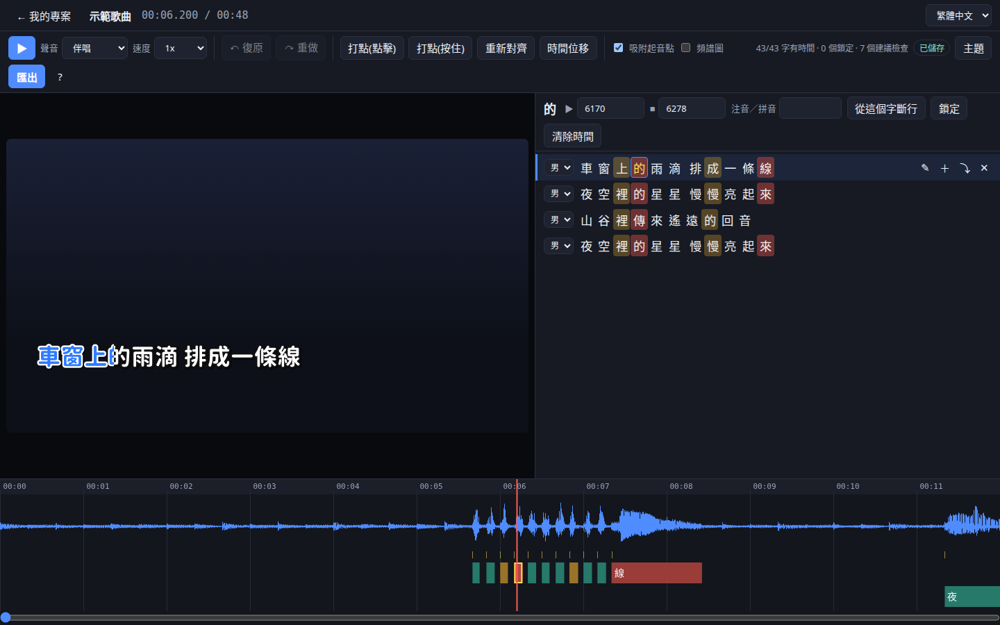
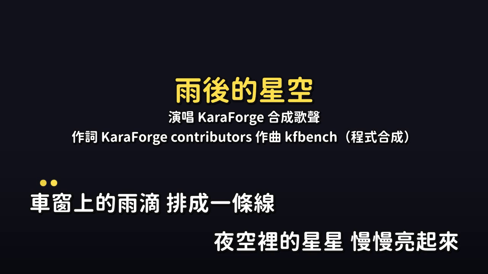
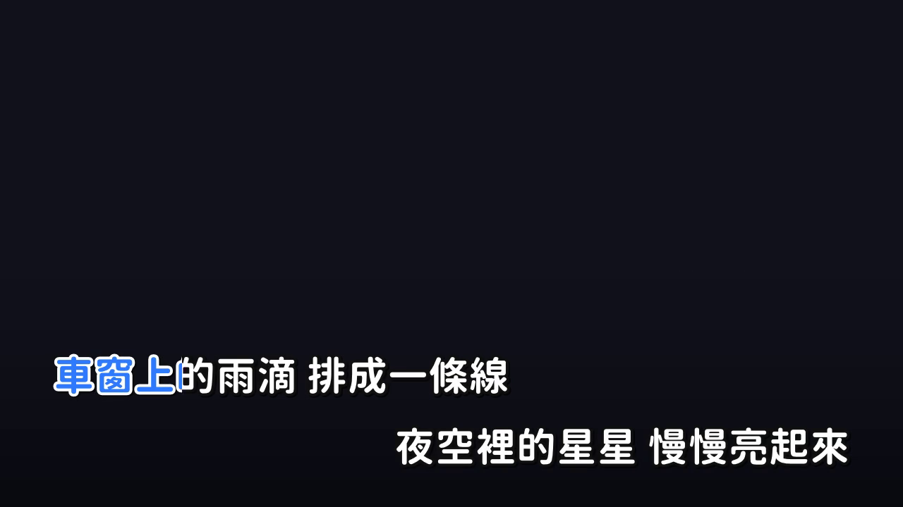
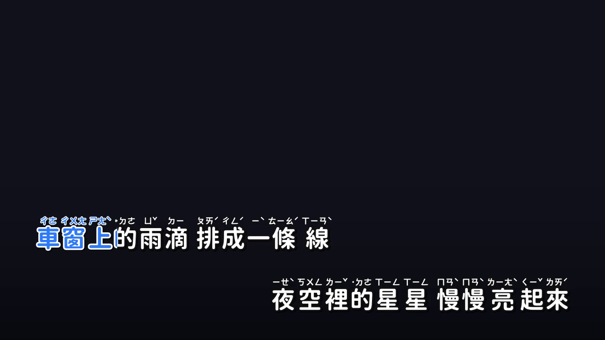

# KaraForge

**開源的 KTV 影片產生器。** 給它一首歌（影片或音檔）和歌詞，它會把歌詞自動對齊到「每一個字」，
讓你在網頁編輯器裡微調，然後輸出台灣 KTV 風格的卡拉 OK 影片——唱到哪個字，那個字連外框一起變色。

English: [README.en.md](README.en.md)



| 匯出的影片：片頭資訊卡與倒數提示 | 唱到的字連外框一起變色 | 注音學習主題 |
|---|---|---|
|  |  |  |

以上三張是 [`examples/demo/`](examples/) 的影片影格：一首程式合成的歌，全自動處理，沒有手動修過。

## 它能做什麼

- **自動逐字對齊。** 人聲分離 → 語音辨識 → 三段式對齊（先把每一行定位，再對齊行內每個字，最後吸附到起音點），每個字附上信心度。
- **半自動修正。** 編輯器把沒把握的字標出來；拖曳、打點（邊聽邊按空白鍵）或直接輸入時間來修正。修過的字會被鎖定，再按一次「重新對齊」，它們就成為錨點。
- **看到的就是輸出的。** 瀏覽器預覽與最後的影片用的是同一份字幕、同一個算繪器（libass）、同樣的字型。
- **KTV 排版。** 雙行交替、由左到右連外框一起填色、長停頓後的倒數提示、男／女／合唱配色、片頭資訊卡、注音或拼音。四套內建主題，可以在編輯器裡調整並另存。
- **多種輸入與輸出。** 歌詞：純文字、LRC（逐行或逐字）、SRT、ASS，或完全不給歌詞（語音辨識產生草稿）。
  輸出：MP4、MKV（軟字幕 + 伴唱／原唱雙音軌）、ASS、LRC、enhanced LRC、SRT、UltraStar。
- **在你自己的電腦上執行。** 模型下載完之後不需要網路，沒有帳號、沒有遙測。CPU 就能跑，預設的模型全部是允許商用的寬鬆授權。
- **命令列與網頁介面共用同一個專案格式**（一個資料夾加一份看得懂的 `project.json`），也可以整個資料夾批次處理。

## 它有多準——以及我們還不知道的事

我們用自己合成的歌曲（語音合成的歌聲 + 合成伴奏，所以知道每個字的標準答案）評測。
**預設的 `balanced` 設定檔**在測試分組（30 首 × 4 種訊噪比＝120 個音檔、7480 個字）上的結果：

| 歌詞語言 | 起始時間誤差中位數 | P95 | 需要手動修正的字（誤差 > 0.15 秒） |
|---|---:|---:|---:|
| 中文 | 12 ms | 124 ms | 4.3% |
| 英文 | 17 ms | 147 ms | 4.8% |
| 中英混合 | 16 ms | 402 ms | 10.5% |

規格訂的目標（中文、訊噪比 10 dB：中位數 ≤ 60 ms、P95 ≤ 250 ms、需修正 ≤ 10%、鎖定 5% 錨點後 ≤ 5%）四項都達成，
實測是 11 ms、86 ms、2.8%、3.0%。完整的表格（含消融實驗與各對齊器的比較）在
[docs/benchmark-report.md](docs/benchmark-report.md)，怎麼量的在 [docs/benchmark.md](docs/benchmark.md)。

請把這些數字當成**上限的參考**，原因我們直接講：

- **全部來自合成歌聲。** 合成的歌聲咬字清楚、沒有轉音與和聲，伴奏也單純。真人演唱的歌曲一定比較差，差多少**沒有量過**（專案不能附帶有版權的歌）。你可以用自己的歌量：見 [bench/real/README.md](bench/real/README.md)。
- **中英混合的歌詞明顯比較弱**，大約每十個字要修一個。
- **`cpu-lite`（最小的模型組合）差很多**：它的對齊器在同一份測資上有約兩成的字需要修正。
- **沒有歌詞時的語音辨識草稿錯很多**：在我們唯一量過的例子上，最好的設定檔也只對了一半（[細節](docs/lyrics-format.md#沒有歌詞語音辨識草稿)）。有歌詞就貼歌詞。
- 沒有 GPU 的機器上開發，**GPU（CUDA、Apple MPS）、macOS、Windows 都沒有實測過**。

## 安裝

需要：Python 3.11 以上、[uv](https://docs.astral.sh/uv/)、含 libass 的 ffmpeg、Node.js 22.12 以上（只有建置網頁介面時需要；開發時用的是 26）。
另外預留約 3 GB 磁碟空間給模型。目前沒有發布到 PyPI，請從原始碼安裝，或使用 Docker。

### 原生安裝

```bash
git clone <這個儲存庫的網址> karaforge
cd karaforge

uv sync --extra cpu                 # 有 NVIDIA 顯示卡：改成 --extra cuda
source .venv/bin/activate           # Windows：.venv\Scripts\activate
(cd web && npm ci && npm run build) # 建置網頁介面（只用命令列的話可以跳過）

kf doctor                           # 檢查環境：ffmpeg、字型、運算裝置、缺哪些模型
kf models download                  # 下載預設（balanced）需要的模型，約 2.2 GB
```

之後的指令都假設虛擬環境已經啟用（`kf` 找得到）。**請不要用 `uv run kf …`**：`uv run` 會先把環境同步回「沒有 `--extra`」的組合，
也就是把 CPU 版的 PyTorch 換成好幾 GB 的 CUDA 版。真的要用就加 `--no-sync`。

ffmpeg 的安裝方式：

| 系統 | 指令 |
|---|---|
| Ubuntu／Debian | `sudo apt install ffmpeg` |
| macOS（Homebrew） | `brew install ffmpeg` |
| Windows | `winget install Gyan.FFmpeg`（full 版本） |

`kf doctor` 會告訴你找到的 ffmpeg 有沒有 libass；沒有的話只能匯出 MKV 與字幕檔，不能把字幕燒進 MP4。
不能安裝系統套件的環境可以用 Docker 包一層 ffmpeg，見 [docker/ffmpeg-wrapper/README.md](docker/ffmpeg-wrapper/README.md)。

### Docker

```bash
git clone <這個儲存庫的網址> karaforge
cd karaforge
mkdir -p projects
KARAFORGE_UID=$(id -u) KARAFORGE_GID=$(id -g) docker compose -f docker/docker-compose.yml up --build
```

然後開啟 <http://127.0.0.1:8765>。專案存在儲存庫根目錄的 `projects/`（先自己建立，才不會被 Docker 以 root 建立；
`KARAFORGE_UID`／`KARAFORGE_GID` 讓容器用你的使用者身分寫入）。模型存在具名的 volume 裡，第一次處理時下載，不會打包進映像。
映像大約 3.7 GB。

在容器裡使用命令列（把歌曲與歌詞放進 `projects/`）：

```bash
KARAFORGE_UID=$(id -u) KARAFORGE_GID=$(id -g) docker compose -f docker/docker-compose.yml run --rm karaforge \
  auto /data/projects/song.mp3 /data/projects/lyrics.txt -o /data/projects/song-ktv.mp4
```

有 NVIDIA 顯示卡與 nvidia-container-toolkit 的話：`docker compose -f docker/docker-compose.yml --profile gpu up --build karaforge-gpu`。
CUDA 映像（約 13 GB）可以建置，也能在沒有顯示卡的機器上啟動並退回 CPU；但**沒有在有顯示卡的機器上執行過**，GPU 推論是否正常我們不知道。

## 快速開始

### 一行指令

```bash
kf auto song.mp3 lyrics.txt -o song-ktv.mp4
```

歌詞檔一行一句就可以（格式見 [docs/lyrics-format.md](docs/lyrics-format.md)）：

```text
# title: 夜空中的旅人
# artist: 示範樂團

[男] 車窗上的雨滴 排成一條線
[女] 夜空裡的星星慢慢亮起來
[合] 我們一起唱 la la la
```

### 用網頁介面

```bash
kf serve --open
```

1. 「新增專案」：拖進影片或音檔，貼上歌詞，選處理品質，開始。
2. 處理完會進入編輯器。黃色與紅色的字是系統沒把握的：點一下會跳到那裡，聽聽看。
3. 不對的字：在時間軸上拖曳它，或按 `1` 進入打點模式，邊播放邊在每個字開始時按空白鍵。
4. 修了幾個字之後按「重新對齊」，其餘的字會以你修的為準重新計算。
5. 「匯出」。

常用快捷鍵：`空白鍵` 播放／暫停、`←` `→` 微調 10 毫秒（加 `Shift` 是 50）、`Tab` 下一個字、`L` 鎖定、`Ctrl+Z` 復原、`?` 全部的快捷鍵。

### 分步驟的命令列

```bash
kf new song.mp4 --lyrics lyrics.txt -o my-song.kfproj
kf run my-song.kfproj                 # 分離、辨識、對齊（有快取，重跑很快）
kf export my-song.kfproj --format mkv # 軟字幕 + 伴唱／原唱雙音軌
kf export my-song.kfproj --format lrc
kf batch ./songs/ --out ./exports/    # 資料夾裡同名的歌與歌詞配對後全部處理
```

完整說明：[docs/cli.md](docs/cli.md)。

## 該選哪個處理品質

| 設定檔 | 適合 | 下載量 |
|---|---|---|
| `balanced`（預設） | 一般使用。CPU 就能跑，所有模型允許商用。 | 約 2.2 GB |
| `cpu-lite` | 先試試流程、之後打算自己手動打點、或磁碟很小。對齊明顯較不準。 | 約 0.2 GB |
| `gpu-quality` | 有 GPU，或願意多等。最好的語音辨識；裝了選用的 `qwen-asr` 還會用對英文與混合歌詞較準的對齊器。 | 約 3.3–5.2 GB |

我們的機器（Intel i5-10500，6 核，推論限制 8 個執行緒，沒有 GPU）上，`balanced` 處理一分鐘的音訊大約需要一分鐘，
其中一半是人聲分離。細節與每個可調參數：[docs/profiles.md](docs/profiles.md)。

## 常見問題

**一定要有 GPU 嗎？** 不用。所有功能都能在 CPU 上執行，只是比較慢。

**支援哪些語言？** 中文（繁體、簡體）與英文有評測數據。日文假名、韓文可以處理（有基本的拼音轉換），但沒有評測過。台語、客語、粵語歌詞可以對齊文字，但自動讀音只有國語。

**對不準怎麼辦？** 先看是不是整行都偏了（通常是語音辨識沒聽懂那一行）：把那一行的第一個字拖到正確位置，再按重新對齊。
零星的字：直接拖曳或用打點模式。副歌重複的歌，確認歌詞裡每一次重複都有寫出來。

**伴奏裡還聽得到一點人聲／和聲。** 預設的分離模型是「伴唱型」：刻意把和聲留在伴奏裡，比較像真正的 KTV 伴唱帶。主唱偶爾會有殘留，這是分離模型的極限。

**可以只要字幕，不要重新壓影片嗎？** 可以：`kf export --format ass`（或 `lrc`、`srt`）只輸出字幕檔，用播放器搭配原影片載入即可。`--format mkv` 的字幕是可以關掉的軟字幕，但畫面仍然會重新編碼。

**破音字的注音不對。** 自動讀音是查表的，遇到破音字不一定對（[實測準確率](docs/ruby.md)）。在歌詞裡寫 `行{ㄏㄤˊ}`，或在編輯器選取那個字修改讀音。

**模型放在哪裡？可以離線用嗎？** `~/.local/share/karaforge/models/`（可用 `KARAFORGE_HOME` 改）。下載完之後完全離線；`KARAFORGE_OFFLINE=1` 可以確保它不會嘗試連線。

**可以讓別人連到我的 `kf serve` 嗎？** 伺服器沒有登入機制，預設只接受本機連線。除非在可信任的網路裡，否則不要改 `--host`。

**專案檔可以自己改嗎？** 可以，`project.json` 就是設計成人看得懂的：[docs/project-format.md](docs/project-format.md)。

## 文件

| | |
|---|---|
| [命令列參考](docs/cli.md) | [歌詞格式](docs/lyrics-format.md) |
| [專案格式](docs/project-format.md)（[JSON Schema](docs/project.schema.json)） | [主題](docs/themes.md) |
| [處理品質與參數](docs/profiles.md) | [注音與拼音](docs/ruby.md) |
| [對齊演算法](docs/alignment.md) | [評測方法](docs/benchmark.md)、[評測報告](docs/benchmark-report.md) |
| [架構](docs/architecture.md) | [撰寫 adapter](docs/adapters.md) |
| [授權清單](docs/LICENSES.md) | [設計決策紀錄（ADR）](docs/adr/) |
| [最終報告](REPORT.md)（驗證了什麼、沒驗證什麼） | [更新紀錄](CHANGELOG.md) |

示範專案與影片在 [`examples/`](examples/)。

## 版權提醒

KaraForge 不提供任何歌曲、影片或歌詞。**你必須自行確認擁有（或已取得）所使用音樂與歌詞的相關權利**，並自行負責輸出影片的使用方式。
把有著作權的歌曲做成卡拉 OK 影片並公開散布，通常需要權利人的授權。

## 授權

程式碼以 [Apache-2.0](LICENSE) 授權。內建字型是 SIL OFL 1.1。模型權重不隨專案散布，由使用者下載；
預設用到的模型都允許商用，唯一的例外（`mms-fa`，CC-BY-NC）必須明確同意才會下載。瀏覽器預覽使用的 JASSUB 是 LGPL。
依 README 用 `uv sync` 裝出來的執行環境與打包後的網頁介面不含 GPL 或非商業授權的程式——有三個間接相依為此被排除，
而這個排除對 `pip install` 無效；開發用的評測工具則會安裝 GPL 套件。
完整清單與說明：[docs/LICENSES.md](docs/LICENSES.md)。

## 開發

```bash
make setup      # uv sync（含評測工具）+ npm ci
make check      # ruff、pyright、不需要模型的測試、前端的型別檢查／lint／測試
make test-all   # 全部測試（需要已下載的模型與 ffmpeg）
(cd web && npm run e2e)   # 瀏覽器端對端測試（Playwright）
```

這個專案的第一版是由 AI（Claude）依照一份規格從頭寫成的；開發過程、驗證了什麼、沒驗證什麼，都記錄在 [REPORT.md](REPORT.md)。
